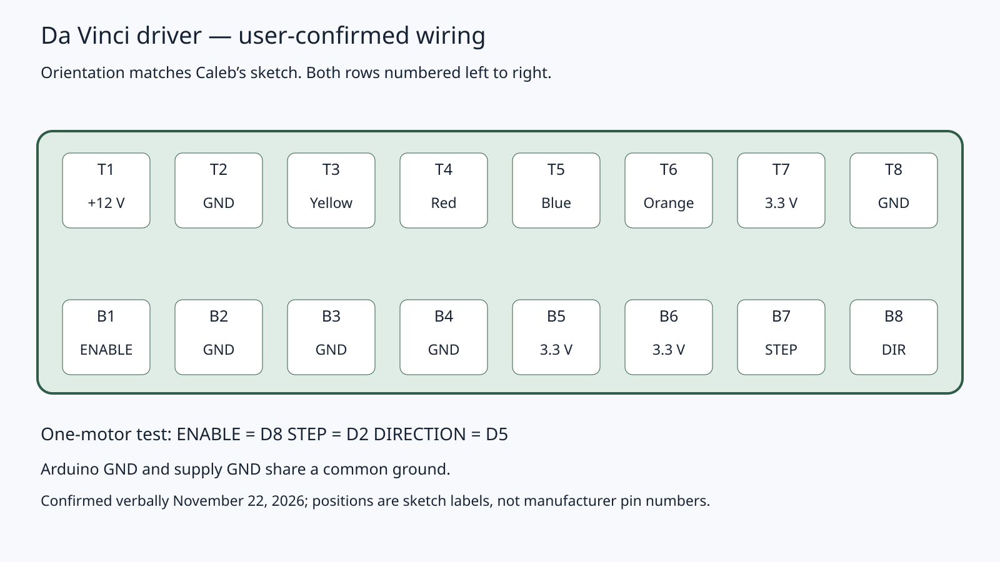

# Confirmed driver wiring

Caleb confirmed these connections individually on November 22, 2026, describing this as his working test layout. T/B labels refer to his sketch orientation, with both rows numbered left to right; they are not manufacturer pin numbers. Preserve that orientation when using the diagram.

| Position | Connection |
| --- | --- |
| T1 | PSU +12 V |
| T2 | Common GND |
| T3 | Motor yellow |
| T4 | Motor red |
| T5 | Motor blue |
| T6 | Motor orange |
| T7 | PSU 3.3 V |
| T8 | Common GND |
| B1 | ENABLE signal; Uno D8 in one-motor test |
| B2 | Common GND |
| B3 | Common GND |
| B4 | Common GND |
| B5 | 3.3 V |
| B6 | 3.3 V |
| B7 | STEP signal; Uno D2 in one-motor test |
| B8 | DIRECTION signal; Uno D5 in one-motor test |

Arduino GND connects to the same common ground. Keep 12 V and 3.3 V separate. Motor coil pairs reported by Caleb: yellow/red and blue/orange.

Use signal functions when duplicating the driver harness: each axis needs separate STEP and DIR assignments; ENABLE may be shared. D8/D2/D5 describe the one-motor test, not every axis.

This records the user's tested harness, rather than an independent identification of every driver pin function. B2–B6 are recorded by their connections without guessing internal function. Driver current limit, signal voltage tolerance and full-machine calibration are not established by this wiring confirmation. Earlier exploratory notes that say these connections remain unknown predate this confirmation.
